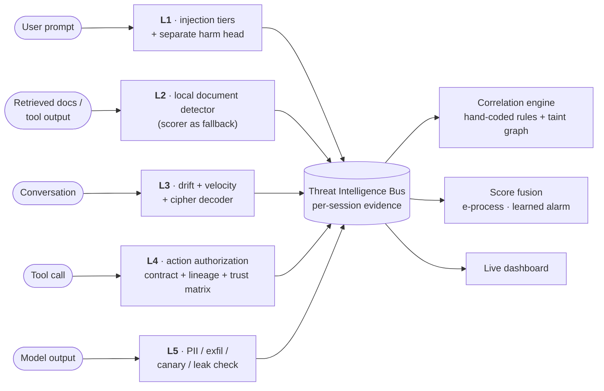

<div align="center">

<picture>
  <source media="(prefers-color-scheme: dark)" srcset="assets/logo/dida-logo-dark.svg">
  
</picture>

### Defense-in-Depth Architecture for Secure Conversational AI

**Five security layers in front of your LLM app, plus a hard look at whether stacking them actually works.**


[Since the paper](#since-the-paper) ·
[What it does](#what-it-does) ·
[Results](#results) ·
[The research](#research) ·
[Contributions A–H](#contributions) ·
[Architecture](#architecture) ·
[Quick start](#quick-start) ·
[Reproduce](#reproduce)

</div>

---

## ⚡ TL;DR

- 🧱 **A runtime proxy** that screens every prompt, retrieved document, conversation, tool call and model output, with calibrated thresholds and a shared per-session evidence bus.
- 🤖 **On a live Gemini agent** (AgentDojo), DIDA's tool-call check alone cuts attack success from **58.8% to 10.3%** with **zero loss** of benign task success. The full defense gets it to **4.4%**.
- 🔬 **A research result:** layered guardrails don't compose the way people assume. No detector that reads threshold crossings can catch an attacker who keeps every layer just under its threshold. And no statistically valid fusion beats the best single layer unless it assumes the layers are independent. We prove both, then show they hold on DIDA **and** on a second stack built from third-party parts (LLM Guard + Llama Guard 3).
- 📒 **Nothing hand-waved:** every number below comes from [`results.md`](results.md), the full lab log of every run, bug, fix and superseded figure.

---

<a id="since-the-paper"></a>

## 🆕 Since the paper (October–November 2026)

The results tables further down are the paper's measurements (September 2026). The work since then ran in rounds
with pre-registered DEV / VAL / one-time TEST protocols on fresh, untouched test draws; everything is logged in
[`results.md`](results.md) §18–§21 (current board: §21, metrics and 95 % intervals: §21.1).

| Layer | What changed | Shipped by default? | Measured (fresh test draws) |
|---|---|---|---|
| **L2** documents | A **local document detector**: a 4-bit Qwen3-4B reads the document under a document policy and a linear probe on its residual stream decides, with split-conformal thresholds per content type. Code and prose go to separate probes; non-English prose segments get one more reading translated to English (opus-mt-mul-en); long documents are read in windows, hidden-character text unhidden. | **Yes**, since 2026-11-03 (`L2_LOCAL_DETECTOR=authoritative`, `L2_LOCAL_PROBE_ROUTING`, `L2_LOCAL_TRANSLATE_VIEW`). Without the local model it falls back to the earlier scorer. | BIPIA **0.969**; injection in the middle of a document **0.926** (long documents 0.930); injections translated into German / French / Spanish / Italian / Russian / Dutch **0.94–1.00**, Chinese 0.916; DIDA **1.0**. False positives: pasted passages 1.8 %, code 0.7 %, e-mail and translated benign text 0. **v8 (default since 2026-11-07):** foreign script runs inside lines translated, Chinese through opus-mt-zh-en plus a mood-keeping translation by the local model, canonical whitespace, recalibrated thresholds, and two speed-ups with identical decisions (early exit after the probe layer; the soft scorers skipped once the detector answered: ingest 2.5 s -> **0.6 s**). Eleventh untouched draw, read once: precision **0.992**, recall **0.959**, F1 0.975, FP 1.10 %, AUROC 0.996; Chinese **0.973**, German 0.958, pasted passages **1.41 %**, whitespace flips 0. |
| **L4** tool calls | **Action authorization** at the tool boundary: an intent contract (which actions the user asked for, with which values), value lineage (where every argument came from: the user, a system of record, or document text) and a trust matrix per argument class. | **Yes**, since 2026-10-23 (`L4_AUTHZ`; the contract is written by a hosted model, with a lexicon fallback). | AgentDojo, 398 held-out attack pairs, effect-level replay: 3 attacks with an effect when the user declines unexpected confirmations (0.8 %). |
| | A **fully local profile**: the contract and a per-call alignment check written by the local Qwen3-4B (nothing leaves the machine), copied-argument guards, and a named-source rule for actions the user did not ask for. | No (opt-in profile). | AgentDojo held-out: 0 / 398 with a declining user, 38 / 398 when every confirmation is approved — statistically the same as the hosted candidate (paired McNemar p = 0.79); InjecAgent 100 % stopped, 0 / 34 benign held; Agent Security Bench 99.5 % stopped. **Named-source rule** (2026-11-06, `L4_NAMED_SOURCE_AUTHORITY`, in the local profile): a value from a document the user pointed at, of the kind the user asked for, needs no confirmation unless the text around it reads as an injection — benign tasks prompted 16.5 % → 8.2 %. **v10** (adds v8's necessity question, guarded so it cannot turn a block into a confirmation, and an entity anchor): **5.2 %** of benign tasks prompted, benign utility 0.41 → **0.52**, still **0 / 398** attacks with a declining user, whose utility under attack (0.46) now equals that of a user who approves everything. |
| **L1** prompts | A local judge and residual-probe ensemble (Qwen3-4B) plus a ProtectAI feature. | No (`L1_LOCAL_JUDGE`, `L1_LLM_PROBE`). | Untouched TensorTrust split (800 attacks): shipped **0.465** → candidate **0.805**, at a NotInject false-positive rate of 4.4 %. |
| | v8 round (2026-11-06): probe score S1 plus **AUTH**, which lets the local probe overrule soft-tier false alarms (hard pattern matches keep their verdict). | No (best measured, below the mark). | Fourth untouched TensorTrust split (537), read once: hijacking **0.853**, extraction **0.713** (shipped 0.523 / 0.448); fifth untouched split (800), read once: **0.802 / 0.783** (shipped 0.500 / 0.450); NotInject false positives **2.65 %** (shipped 3.24 %); pooled precision 0.98–0.99. A probe adapted on the spent TensorTrust sets (v10) adds ~4 points on a sixth untouched split: **0.832 / 0.780**, NotInject 2.95 %. A **fine-tuned classifier** stage (v11, ProtectAI DeBERTa tuned on the spent sets) on a seventh untouched split: **0.846 / 0.843**, NotInject **1.77 %**, precision 0.991. |
| **L5** outputs | **Field policy**: the operator declares which record fields a task may disclose; L5 matches the other fields' values exactly. | No (`L5_FIELD_POLICY`; for sessions with a declared policy). | AgentLeak scenario split, TEST read once: recall **1.000**, false positives **0.91 %**, precision 0.976 (shipped 0.900 / 5.3 %). On AgentLeak the check mirrors how the label is built: it shows the policy is enforced, not that L5 infers which fields are private. |

**Every metric, every layer** (shipped configuration unless marked; 95 % Wilson intervals; AUROC / AUPRC ranked against
all benign rows of the same run; latency per item on an i5-12500H laptop with a 4 GB RTX 3050). Full tables, one row per
dataset slice, with sources: [`results.md`](results.md) §21.5.

| Layer · benchmark | n attack / benign | Recall [95 % CI] | FP rate [95 % CI] | Precision | F1 | AUROC | AUPRC | Latency mean / p95 |
|---|---|---|---|---|---|---|---|---|
| **L1** TensorTrust untouched + DIDA vs NotInject + Alpaca + DIDA benign | 859 / 892 | 0.502 (TensorTrust 0.465 [0.431, 0.500]) | 1.35 % (NotInject 3.24 % [1.82, 5.72]) | 0.973 | 0.662 | 0.854 | 0.875 | 0.2–0.5 / 0.2–1.9 s |
| L1 probe candidate (off) | 859 / 892 | 0.789 (TensorTrust 0.774 [0.744, 0.801]) | 1.57 % (NotInject 3.83 %) | 0.980 | 0.874 | 0.916 | 0.931 | 1.7–2.3 / 2.4–5.2 s |
| L1 S1 + AUTH (off; v8, fourth untouched TensorTrust split, read once) | 537 / 892 | 0.816 (hijacking 0.853 [0.814, 0.884], extraction 0.713 [0.634, 0.781]) | 1.01 % (NotInject 2.65 % [1.40, 4.97]) | 0.980 | 0.890 | 0.983 (score) | 0.978 | probe stage 1.7–2.3 s |
| L1 S1 + AUTH (off) · fifth untouched TensorTrust split, read once | 800 / 892 | 0.795 (hijacking 0.802 [0.765, 0.835], extraction 0.783 [0.733, 0.826]) | 1.01 % (NotInject 2.65 % [1.40, 4.97]) | 0.986 | 0.880 | 0.981 (score) | 0.982 | probe stage 1.7–2.3 s |
| L1 v10 = S1 + AUTH + domain-adapted probe (off) · sixth untouched TensorTrust split, read once | 800 / 892 | 0.813 (hijacking 0.832 [0.797, 0.862], extraction 0.780 [0.730, 0.823]) | 1.12 % (NotInject 2.95 % [1.61, 5.34]) | 0.985 | 0.890 | 0.987 (score) | 0.987 | probe stage 1.7–2.3 s |
| **L1 v11 = v10 + fine-tuned classifier (off) · seventh untouched TensorTrust split, read once** | 800 / 892 | **0.845** (hijacking 0.846 [0.812, 0.875], extraction 0.843 [0.798, 0.880]) | **0.67 %** (NotInject **1.77 %** [0.81, 3.81]) | **0.991** | **0.912** | 0.989 (score) | 0.989 | probe stage 1.7–2.3 s + 11 ms |
| L1 v12 = v10 + PIGuard-based fine-tuned stage (off) · eighth untouched TensorTrust split, read once | 800 / 892 | 0.834 (hijacking 0.824 [0.788, 0.855], extraction 0.850 [0.805, 0.886]) | 1.35 % (NotInject 3.54 % [2.04, 6.08]) | 0.982 | 0.902 (accuracy 0.914, balanced 0.910, MCC 0.836) | 0.988 (score) | 0.988 | real runner, whole L1: 6.4 / 8.7 s (stage alone 0.37 / 0.89 s) |
| **L1H** harm head · WildJailbreak | 2,000 / 210 | 0.738 [0.718, 0.757] | 4.29 % [2.27, 7.94] | 0.994 | 0.847 | 0.952 | 0.992 | 2.8 / 5.8 s |
| **L2** BIPIA, middle-of-document, translated attacks vs pasted, code, e-mail, translated benign (t9 TEST) | 1,985 / 1,822 | 0.952 (lowest row: Chinese 0.916) | 0.60 % (highest row: pasted 1.76 %) | 0.994 | 0.973 | 0.996 | 0.997 | 3.1–3.8 / 6.3–9.7 s per document |
| **L2 v8 (default)** · eleventh untouched draw (t11, stratified), read once; real runner | 2,180 / 1,630 | **0.959** (lowest row: Dutch 0.919) | 1.10 % (pasted 1.41 %; translated benign Chinese 4.35 %, Dutch 2.08 %) | **0.992** | **0.975** | **0.996** | **0.997** | **0.92 / 2.87 s** per document (VAL ingest 0.62 / 1.19 s) |
| **L3** tom-gibbs multi-turn | 4,136 / 1,200 | 0.984 [0.980, 0.987] | 0 % [0, 0.32] | 1.000 | 0.992 | 0.996 | 0.998 | 0.39 / 0.48 s |
| L3 · MHJ vs audited WildChat | 110 / 646 | 0.082 [0.044, 0.148] | 3.10 % [2.01, 4.73] | 0.310 | 0.130 | 0.682 | 0.249 | 0.56 / 1.3 s |
| **L4** InjecAgent (direct + data stealing) | 1,054 / 34 | 1.000 [0.996, 1.000] | 0 % [0, 10.2] | 1.000 | 1.000 | 1.000 | — | 0.45 / 0.58–0.66 s |
| L4 · Agent Security Bench (local profile) | 1,200 / 100 | 0.995 [0.989, 0.998] | 29 % prompted [21.0, 38.5] | 0.976 | 0.986 | 0.871 | 0.979 | not stored |
| L4 · AgentDojo held-out (local profile, effect replay) | 398 / 97 | attack success 0 [0, 0.010] declining, 0.095 [0.070, 0.128] approve-all | 16.5 % of benign tasks prompted [10.4, 25.1] | — | — | — | — | not stored |
| L4 · AgentDojo held-out, local profile + named-source rule + guarded necessity + entity anchor (v10, adopted 2026-11-06) | 398 / 97 | attack success 0 [0, 0.010] declining, 0.096 [0.070, 0.128] approve-all | 5.2 % of benign tasks prompted [2.2, 11.5] | 0.794 (refusals, calls) | 0.672 (calls) | — | — | 3.7 s per benign task (harness, all L4 checks) |
| **L5** AgentLeak | 1,355 / 3,651 | 0.875 [0.857, 0.892] | 4.85 % [4.20, 5.59] | 0.870 | 0.873 | 0.911 | 0.795 | 0.04 / 0.10 s |
| L5 with a declared field policy (off; scenario TEST, read once) | 290 / 771 | 1.000 [0.987, 1.000] | 0.91 % [0.44, 1.86] | 0.976 | 0.988 | 0.994 | 0.976 | 0.007 / 0.021 s |
| **L6** answer guard (off) · live AgentDojo answers, validation | 16 / 97 | 0.938 [0.717, 0.989] | 0 % [0, 3.8] | 0.577 | 0.714 | — | — | not stored |
| **Pipeline** DIDA-Bench (Sept. 2026 configuration) | 59 / 53 | 0.915 blocked (59 / 59 blocked or warned) | 0 / 53 | — | — | — | — | 0.52 / 0.75 s |
| Pipeline · benign traffic arm (Sept. 2026) | — / 529 | — | 1.5 % blocked, **33 % warned** | — | — | — | — | 1.8 / 3.1 s |

**Meets the mark:** L2 (v8 default; every row of the eleventh untouched draw except Dutch recall 0.919 and translated-benign Chinese / Dutch 4.35 % / 2.08 %, accepted as manageable), L3 on tom-gibbs, L4's attack stopping on InjecAgent and AgentDojo (declining
user), and **L5 when the operator declares a field policy** (AgentLeak TEST: recall 1.000, FP 0.91 %).

**Still below the project's mark** (recall ≥ 0.92 at ~1.7 % false positives per row, and no other weak metric): L1 on
untouched TensorTrust splits (best measured: 0.846 / 0.843 on the seventh split with the fine-tuned classifier, whose NotInject false positives, 1.77 %, are now near the mark); the
L1H harm head (WildJailbreak, and 38.8 % over-refusal on OR-Bench-Hard); L3 on MHJ; L4's benign prompts (ASB 29 %,
AgentDojo 5.2 % with the adopted v10 rules, from 16.5 %; 3 of those 5 are the operator's transfer limit;
InjecAgent's 17-task benign arm is too small to show the mark); L5 without a declared policy; L6 precision; L2's three accepted residual rows (Dutch 0.919; translated-benign Chinese / Dutch); and the pipeline's benign warning rate in the September configuration
(re-measure pending). Each has a logged root cause and a next step in [`results.md`](results.md) §21.

---

<a id="what-it-does"></a>

## 🎯 The attack it was built for

> A user asks their AI assistant to *summarize a report and email it to a colleague*.
>
> 1. The retrieved report contains one sentence that looks like formatting advice. It is really a hidden instruction to forward the summary to an outside address.
> 2. Later, the assistant makes an email call whose recipient matches nothing the user typed.
>
> Neither event alone looks bad enough to block. Together, they're data exfiltration.

LLM apps now read documents, call tools and hold long conversations. That gives an attacker four doors: **the prompt, a poisoned document, a hijacked tool output, and a slow multi-turn escalation**. The industry answer is to stack guardrails. DIDA builds that stack properly, then **tests the premise instead of assuming it**.

---

<a id="results"></a>

## 📊 Results

### 🤖 Defending a live AI agent (AgentDojo)

A real Gemini agent doing real tasks (email, banking, travel, Slack) while attackers plant instructions in its tool outputs. 68 attack scenarios and 34 benign tasks; every pipeline ran every episode.

| Pipeline | Attack success ↓ | Task success under attack ↑ | Task success, no attack ↑ |
|---|:---:|:---:|:---:|
| No defense | 0.588 | 0.529 | 0.853 |
| AgentDojo's built-in detector | 0.015 | 0.206 | 0.471 |
| **DIDA, tool-call check only** | **0.103** | **0.574** | **0.853** |
| **DIDA, full** | **0.044** | 0.309 | 0.794 |

> ✅ **The tool-call check alone cuts attacks about 6× and keeps benign task success exactly the same.**
> The full defense stopped 37 attacks and enabled none (p < 10⁻⁶). AgentDojo's own detector gets its low number by breaking **13 of 34** benign tasks.

### 🧱 Every layer, shipped configuration (paper era, September 2026)

> For the current shipped defaults and their numbers on fresh test draws, see [Since the paper](#since-the-paper). The L2 row below is the scorer that is now the fail-soft fallback.

| Layer | Stops | Benchmark | Result |
|---|---|---|---|
| **L1** injection | prompt injection | TensorTrust (570 attacks) | recall **0.875** |
| | | NotInject / Alpaca (benign) | false positives **3.5% / 0.5%** |
| **L1H** harm intent | jailbreaks hidden in roleplay | WildJailbreak (2,210) | AUROC **0.952**, recall 0.738 @ 4.3% FPR |
| **L2** documents | poisoned retrieval | BIPIA | AUROC **0.928**; held-out recall **0.636** @ **1.3%** FPR |
| **L3** multi-turn | slow-burn and cipher jailbreaks | tom-gibbs (5,336) | AUROC **0.996**, recall 0.984, **0 false positives** |
| **L4** tool calls | agent hijacking | InjecAgent | recall **1.000**, **0 false positives** |
| **L5** output | data leakage | AgentLeak (5,006) | AUROC **0.888** |
| **Pipeline** | multi-vector attacks | DIDA-Bench | **91.5%** blocked, **0** false positives |

### 🔧 What the engineering bought

Each row is a measured root cause and a repair, not a threshold tweak.

| Problem found | Before | After |
|---|:---:|:---:|
| Harmful intent hidden in roleplay (WildJailbreak AUROC) | 0.574 | **0.952** |
| Cipher-encoded multi-turn jailbreaks (tom-gibbs AUROC / FPR) | 0.755 / 10.2% | **0.996 / 0%** |
| Poisoned documents (BIPIA AUROC) | 0.719 | **0.928** |
| Poisoned documents (BIPIA held-out recall @ FPR) | 0.148 @ 4.0% | **0.636 @ 1.3%** |
| Agent hijacking, trace replay (attack execution per suite) | 0.59 / 1.00 / 0.45 / 0.41 | **0.00 / 0.20 / 0.02 / 0.00** |
| Tool-call false alarms on benign agent traffic | 56% of calls | **2–20%** by suite |
| Injection false positives on trigger-word prompts (NotInject) | 11.5% | **3.2%** (judge off) |
| Full-pipeline blocking on DIDA-Bench (0 false positives) | 69.5% | **91.5%** |

### 🥊 Against third-party guards

| | Llama Guard 3 (1B) | ProtectAI DeBERTa v2 | DIDA |
|---|:---:|:---:|:---:|
| WildJailbreak AUROC | 0.814 | 0.653 | **0.952** |
| Multi-turn attacks (MHJ vs. real chats), AUROC | 0.682 | 0.566 | 0.682 (L3); 0.954 (probe, not shipped) |
| Certified sub-threshold sessions caught (SPLIT-Bench v1) | 1 / 340 | 0 / 340 | **265 / 340** (L3) |
| TensorTrust recall | 0.588 | **0.970** | 0.875 |
| False positives on NotInject | 7.4% | 43.4% | **3.5%** |

ProtectAI wins TensorTrust at its default threshold, but it flags 43% of benign trigger-word prompts. Held to DIDA's false-positive rate, its recall falls to 0.779.

---

<a id="research"></a>

## 🔬 The research: do layered defenses compose?

Short answer: **not the way the industry assumes.**

| # | Finding | Evidence |
|:---:|---|---|
| 1 | **Threshold fusion is provably blind** to an attacker who keeps every layer under its threshold | The correlation engine fired **0 times** on SPLIT-Bench v1 (680 sessions) and v2 (510), whose sessions carry machine-checked sub-threshold certificates |
| 2 | **Apparent cross-layer wins are single layers in disguise** | The only mechanism that detected anything, a pattern miner (\|U\| 0.7794 / 0.6706), equals one layer's zero-false-positive ceiling *exactly* |
| 3 | **Valid fusion can't beat the best layer** without assuming independence | An anytime-valid e-process detects a set **identical** to one layer's (Jaccard 1.0000). A learned alarm ranks attacks at AUROC 0.974 but can't operate within a 2% false-alarm budget |
| 4 | **Pipelines destroy evidence at their interfaces** | A four-check audit found **7** such points in DIDA. Llama Guard's safe/unsafe verdict turns an AUROC-0.714 ranking into a single bit (0.500) |
| 5 | **It's not just our system** | Replicated on LLM Guard + Llama Guard 3 with a corpus certified against *that* stack: the deployed rule catches **0/107**, dependence-robust fusion **0**, independence-assuming fusion **10**, exactly as predicted |
| 6 | **More layers can mean more places to hide** | 66.7–85.2% of DIDA's headroom is undefended against a distributed attacker (37.4% on the third-party stack) |

The math is classical: decision fusion, and Vovk and Wang's e-merging. The contribution is turning it into **checks an engineer can run on a real guardrail stack**, and measuring two stacks against them.

---

<a id="contributions"></a>

## 🧬 What sets DIDA apart: contributions A–H

Most guardrail projects ship detectors. DIDA also ships the machinery to **prove what a stack of detectors can and cannot catch**, and to measure it. These eight pieces are what you won't find in an off-the-shelf guardrail toolkit. The letters match the code and the released artifacts.

### Cross-layer mechanisms

| | Contribution | What it does | Measured |
|:---:|---|---|---|
| **A** | **Taint-propagation graph** | Turns a session into a provenance graph (turns → retrieved chunks → tool arguments) and propagates trust along it: `taint(u,v) = 1 − w·(1 − trust(u))`. Flags high-impact calls fed by low-trust content even when no single layer fired. | Fires on exactly the same 7 held-out real attack sessions as the hand-coded RAG-plus-agent rule: it generalizes the rule rather than replacing it *(earlier configuration)* |
| **B** | **Cost-aware sequential triage** | Runs layers as a Wald sequential test (SPRT) and stops as soon as the evidence is decisive, instead of always paying for all five layers. | Accuracy 0.9554, precision 1.0, recall 0.9153, 0 false positives; attacks are decided after **~3.4 of 5 layers** *(earlier configuration)* |
| **C** | **Correlation-pattern mining** | Mines attack-chain patterns from labeled cross-layer event sequences (PrefixSpan-style) instead of hand-writing rules. | Recall **1.0000** on attack-chain types never seen in training (0.8841 on known types), FPR 0.0667 *(earlier configuration)* |
| **D** | **Conformal risk control for false positives** | Sets each threshold with split-conformal calibration on benign data, so the false-positive rate carries a distribution-free guarantee: `k = ⌈(n+1)(1−α)⌉`. | Holds on fresh same-source traffic (0/500 at α = 0.01) and is **shown to break** under shift (14.8% on WildJailbreak's benign set). The failure is reported, not hidden |

### The theory and the measurement kit

| | Contribution | What it does | Measured |
|:---:|---|---|---|
| **E** | **Detectability bound** | Proves that any detector reading only threshold crossings has **zero power** against an attacker who keeps every layer sub-threshold, and turns that into a prediction you can check (\|U\| = 0 on a certified corpus). | The correlation engine fired **0 times** on 510 certified attacks; the one detector that "beat" the bound turned out to be reading a lower threshold, exactly as the corollary says |
| **F** | **Anytime-valid e-value fusion** | Fuses layer scores across layers and turns with e-values: false alarms stay controlled under *any* dependence between layers, at any stopping time. | Recovers exactly the best single layer (Jaccard **1.0000** on both corpora), proving the price of validity. Assuming independence instead catches **10/107**, 9 of which no single layer catches |
| **G** | **SPLIT-Bench, certified sub-threshold corpora** | Generates attack sessions with a **machine-checked certificate** that every layer stays under its threshold while ≥ k layers carry real signal. Certificates are re-verified at import. | 680 sessions (v1) and 510 (v2) against DIDA, plus 447 (SPLIT-S2) against a third-party stack. Hardening DIDA made **0 of 4,080** three-layer attacks certifiable |
| **H** | **Threshold-aware adversary and capacity sweep** | Models the attacker who knows every threshold and computes how much attack signal the stack lets them hide (*effective capacity*). | Every budget up to the capacity (3.002) fits under all thresholds; the first that doesn't is 3.040. 66.7–85.2% of that capacity is undefended. A fusion-aware variant is still certified at a 0.72 rate |

> **Why this matters:** A–D are the cross-layer tricks people usually reach for. E–H explain where each one stops: three of the four reduce to a single layer on certified attacks, exactly as E predicts. That gives you a way to test *your own* guardrail stack before trusting it.

<details>
<summary><b>Where each contribution lives in the code</b></summary>

| | Code |
|:---:|---|
| A | `sentinel/core/taint_graph.py` |
| B | `sentinel/core/sequential_triage.py`, `sentinel/eval/sprt_eval.py` |
| C | `sentinel/core/pattern_mining.py`, `sentinel/eval/pattern_mining_eval.py` |
| D | `sentinel/core/conformal_risk_control.py`, `sentinel/eval/conformal_l1_eval.py` |
| E | `SENTINEL_CONTRIBUTION_E_THEORY.md`, `sentinel/eval/run_phase4_ablation.py` |
| F | `sentinel/core/evidence_fusion.py`, `sentinel/eval/eprocess_eval.py` |
| G | `sentinel/eval/split_bench.py`, `sentinel/eval/second_stack.py` |
| H | `sentinel/eval/split_attack.py` |

</details>

---

<a id="architecture"></a>

## 🏗️ Architecture



| Layer | How it works |
|---|---|
| **L1** | Regex → semantic templates → Prompt Guard × PIGuard (an AND, which kills trigger-word false positives) → an optional policy judge (gpt-oss-safeguard-20b). Plus a **separate** harm-intent head (Qwen3Guard): fusing it in with `max()` measurably hurt both signals. |
| **L2** | **Default (since 2026-11-03):** a local document detector. A 4-bit Qwen3-4B reads each document under a document policy; a linear probe on its residual stream decides against split-conformal thresholds per content type, with code and prose routed to separate probes, an extra translated-to-English reading for non-English prose segments, windows for long documents and an unhidden reading for hidden-character text. **Fallback** (no local model, or `L2_LOCAL_DETECTOR=off`): Prompt Guard's *injection* head over overlapping segments plus a dangerous-code indicator, with Mondrian split-conformal anchors per content type; short text scored by PIGuard. |
| **L3** | Alignment, cumulative drift and velocity over sentence windows. For substitution-cipher jailbreaks it reverse-substitutes the conversation and scores the **decoded goal** instead of the encoding. |
| **L4** | Every tool has a capability class. **Action authorization** (`L4_AUTHZ`, default since 2026-10-23): an intent contract records which actions the user asked for and with which values; every argument's lineage is traced (the user, a system of record, or document text) and checked against a trust matrix per argument class, so a payee or recipient that only a document supplies needs the user's confirmation or is refused. The **addressee check** asks whether the text around a copied value is *talking to the AI*. A fully local profile writes the contract with the local model. |
| **L5** | PII and exfiltration patterns, canary tokens (including base64), and a provenance leak check that reuses L4's tracing on the output. |

🎚️ Thresholds are **split-conformal, calibrated on benign data only**, so the false-positive rate is guaranteed on traffic like the calibration set. We also report where that guarantee breaks across corpora.

---

## ✨ Engineering highlights

| | |
|---|---|
| 📜 **Certified benchmarks** | A SPLIT-Bench sample is accepted only if a machine-checked certificate proves every layer is under its threshold while at least *k* layers carry signal. Certificates are re-verified at import. |
| 🕵️ **Suspicious of good numbers** | Seven harness defects were caught by treating plausible results as suspect. Examples: a leak benchmark that shared one session across samples (AUROC 0.53 → 0.89 once fixed), and an agent framework that counted an overloaded API as a *successful attack*. |
| 🔒 **Pre-registered gates** | Candidate improvements were adopted only if they passed a gate written before the held-out data was scored. Several failed, and they're reported as failures. |
| 💻 **Runs on a laptop** | Qwen3Guard and Llama Guard run on a 4 GB GPU via split-device placement, matching CPU scores to within 5×10⁻⁶. With the judge off, the whole defense runs locally. |
| 🗂️ **Every run recorded** | Each evaluation saves its full configuration snapshot, indexed in `sentinel/eval/results/LEDGER.jsonl`. |

---

<a id="quick-start"></a>

## 🚀 Quick start

```bash
pip install -r requirements.txt           # the proxy
cp .env.example .env                      # optional API keys (see below)
python main.py                            # proxy + live dashboard → http://localhost:8080
```

- **Python 3.10+.** A GPU is optional.
- **Local models (optional, recommended):** the default L2 document detector uses `Qwen/Qwen3-4B-Instruct-2507` in 4-bit (~2.9 GB of GPU memory) and, for the translated reading, `Helsinki-NLP/opus-mt-mul-en` in `~/.cache/sentinel/mt/opus-mt-mul-en`. Without them L2 falls back to the earlier scorer (fail soft); `L2_LOCAL_DETECTOR=off` restores that path explicitly.
- **Small GPUs:** on a card under 8 GB with a local model configured, the 4B model keeps the GPU and the Qwen3Guard harm head and small classifiers run on the CPU (`SENTINEL_GUARD_DEVICE=auto`, `SENTINEL_CLASSIFIER_DEVICE=auto`; CPU and GPU scores are parity-tested, so only latency changes). Measured on a 4 GB laptop GPU: putting everything on the card spilled 1.4 GB into shared system memory and slowed the document path about 4x. Set either variable to `cuda` to override. Measured harm-head latency per prompt: ~0.1 s on the GPU, ~1.1 s mean / 1.7 s p95 on the CPU, where the guard runs on its own 8-thread worker (`SENTINEL_GUARD_THREADS`) while every other model keeps one thread (`SENTINEL_TORCH_THREADS`, default 1; torch's own pool crashed the full test suite, results.md §21.5.1).
- **Gated models:** Prompt Guard and Llama Guard 3 need their Hugging Face licences accepted (`huggingface-cli login`).
- **Optional keys:**
  - `GROQ_API_KEYS` enables L1's policy judge and L4's hosted intent contract. For a fully local defense set `L1_LLM_JUDGE_ENABLED=false` and either `L4_AUTHZ_CONTRACT=lexicon`, or the measured local L4 profile: `L4_AUTHZ_CONTRACT=local L4_ALIGNMENT_LOCAL=true L4_AUTHZ_TARGET_CRITERIA=true L4_AUTHZ_CONTENT_LINK_CONFIRM=true L4_COPIED_CONTENT_CONFIRM=true L4_AUTHZ_LOCAL_DELEGATION=true` ([`results.md`](results.md) §20.17).
  - `GEMINI_API_KEYS` is used only by the live AgentDojo harness and the benign-data audit.

### 🔌 Core endpoints

| Method | Endpoint | Purpose |
|---|---|---|
| `POST` | `/sentinel/chat` | screen user input |
| `POST` | `/sentinel/rag/ingest` | screen a document before retrieval |
| `POST` | `/sentinel/agent/tool_call` | authorize a tool call before it runs |
| `POST` | `/sentinel/agent/tool_response` | scan a tool output |
| `POST` | `/sentinel/output/scan` | scan a model response |
| `WS` | `/ws/events` | live event stream |

---

<a id="reproduce"></a>

## 🧪 Reproducing the results

```bash
pip install -r requirements-eval.txt
python -m sentinel.eval.runner --layer L1 --dataset tensortrust       # any layer × dataset
python -m sentinel.eval.runner --pipeline                             # full pipeline, DIDA-Bench
python -m sentinel.eval.split_bench                                   # generate certified SPLIT-Bench
python -m sentinel.eval.eprocess_eval                                 # anytime-valid fusion
python -m sentinel.eval.agentdojo_l4 --attacks --max-pairs 60         # L4, trace replay
python -m sentinel.eval.agentdojo_live --pairs 20 --benign 10         # live agent (resumable)
python -m sentinel.eval.guard_baseline --backend llama-guard-3-1b     # third-party baselines
python -m sentinel.eval.second_stack build && python -m sentinel.eval.second_stack analyze
```

## 📁 Repository layout

```
main.py                    entry point
sentinel/                  the DIDA package (directory keeps the project's original name)
├── app.py                 FastAPI proxy and WebSocket
├── config.py              every threshold and feature flag, shipped defaults documented inline
├── core/                  threat bus, correlation, taint graph, e-value fusion, conformal calibration,
│                          addressee cues, split-device GPU placement, local judge (Qwen3-4B),
│                          artifacts/ (probe artifacts for L1 / L2)
├── layers/                L1 · L2 (layer2_rag/) · L3 · L4 (layer4_agentic/) · L5 (layer5_output/)
└── eval/                  harness, dataset loaders, SPLIT-Bench generator + certificates,
    └── data/              live AgentDojo, guard baselines, second-stack audit; our benchmarks
dashboard/static/          real-time monitoring dashboard
results.md                 the complete lab log
```

Third-party corpora (AgentDojo, InjecAgent, BIPIA, AgentLeak, WildJailbreak, MHJ, tom-gibbs, OR-Bench, WildChat, OpenAssistant) are fetched from their sources by `sentinel/eval/dataset_loaders.py` and are not redistributed. Neither is any corpus containing real users' conversation text.

---

<div align="center">

**Built by Gokul Iyer**

</div>
